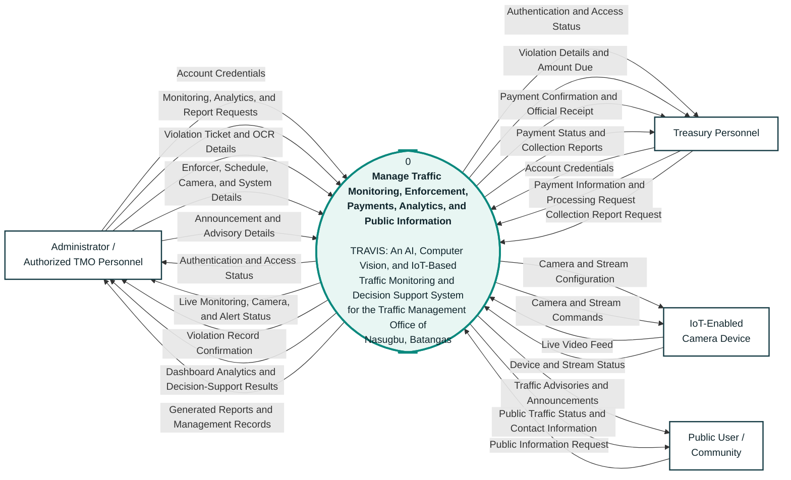

# TRAVIS System Context Diagram

This context diagram represents the entire TRAVIS system as one process and
shows its interactions with external users and devices. Internal processes,
database tables, and data stores are intentionally excluded because they
belong in Diagram 0 and the lower-level DFDs.

## Context Diagram

## External entities and responsibilities

| External entity | Information provided to TRAVIS | Information received from TRAVIS |
|---|---|---|
| Administrator / Authorized TMO Personnel | Credentials, monitoring and analytics requests, violation and OCR details, enforcer and schedule details, camera configuration, system settings, report requests, and public announcements | Access status, monitoring and camera status, alerts, violation confirmation, analytics, predictions, management records, and generated reports |
| Treasury Personnel | Credentials, payment information, payment processing request, and collection report request | Access status, violation balance, payment confirmation, official receipt, payment status, and collection reports |
| IoT-Enabled Camera Device | Live video feed and device or stream status | Camera configuration and stream commands |
| Public User / Community | Public information request | Traffic advisories, announcements, public traffic status, and office contact information |

## Data-flow grammar check

All arrow labels are nouns or noun phrases because they describe information
being transferred. Examples include:

- `Live Video Feed`
- `Violation Ticket and OCR Details`
- `Payment Information and Processing Request`
- `Dashboard Analytics and Decision-Support Results`
- `Traffic Advisories and Announcements`

The central process uses verbs because it describes what the system does:

> **Manage Traffic Monitoring, Enforcement, Payments, Analytics, and Public
> Information**

## Alignment with the implemented system

1. Monitoring covers vehicle counting, inbound and outbound counting,
   congestion assessment, officer-presence detection, collision detection,
   live camera viewing, and alert generation.
2. Violations are entered manually or through OCR-assisted ticket scanning;
   the camera does not automatically determine ticketable violations.
3. Treasury personnel validate payments, record collections, issue official
   receipts, and access payment reports.
4. Decision support uses monitoring, violation, and payment records to present
   trends, predictions, risk information, and hotspot results.
5. Authorized TMO personnel manage traffic enforcers, duty assignments,
   cameras, system users, reports, settings, and public announcements.
6. The public website provides announcements, traffic advisories, public
   traffic status, and contact information to the community.

## Context-diagram rules applied

- Only one system process is shown and numbered `0`.
- No database or data-store symbol is included.
- No internal module is represented as an external entity.
- Every data flow connects an external entity and the TRAVIS system.
- Every process label is action-oriented, while every arrow label identifies
  the data being transferred.

