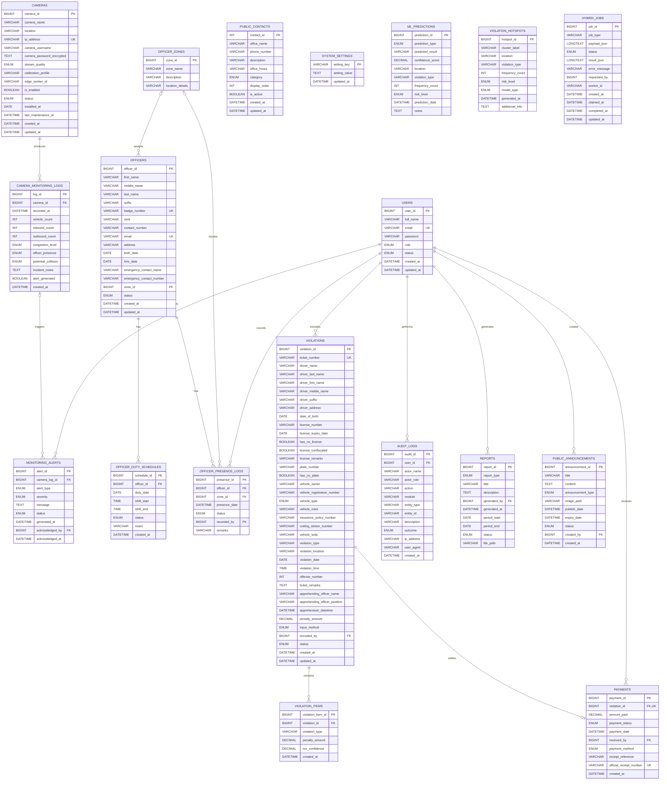

# TRAVIS Database Entity–Relationship Diagram

This ERD represents the latest intended TRAVIS schema based on
`database/travis.sql` and the migrations in `database/`. It covers the user,
traffic monitoring, enforcement, payment, analytics, reporting, public portal,
and hybrid edge-worker domains.

## Complete logical ERD

## Relationship summary

| Parent | Child | Cardinality | Foreign key | Delete behavior |
|---|---|---:|---|---|
| `users` | `violations` | 1 to many | `violations.encoded_by` | Set null |
| `users` | `payments` | 1 to many | `payments.received_by` | Set null |
| `users` | `audit_logs` | 1 to many | `audit_logs.user_id` | Set null |
| `users` | `monitoring_alerts` | 1 to many | `monitoring_alerts.acknowledged_by` | Set null |
| `users` | `officer_presence_logs` | 1 to many | `officer_presence_logs.recorded_by` | Set null |
| `users` | `reports` | 1 to many | `reports.generated_by` | Set null |
| `users` | `public_announcements` | 1 to many | `public_announcements.created_by` | Set null |
| `cameras` | `camera_monitoring_logs` | 1 to many | `camera_monitoring_logs.camera_id` | Cascade |
| `camera_monitoring_logs` | `monitoring_alerts` | 1 to many, optional parent | `monitoring_alerts.camera_log_id` | Set null |
| `officer_zones` | `officers` | 1 to many, optional zone | `officers.zone_id` | Set null |
| `officer_zones` | `officer_presence_logs` | 1 to many, optional zone | `officer_presence_logs.zone_id` | Set null |
| `officers` | `officer_duty_schedules` | 1 to many | `officer_duty_schedules.officer_id` | Cascade |
| `officers` | `officer_presence_logs` | 1 to many | `officer_presence_logs.officer_id` | Cascade |
| `violations` | `violation_items` | 1 to many | `violation_items.violation_id` | Cascade |
| `violations` | `payments` | 1 to zero-or-one | `payments.violation_id` | Cascade |

## Important modeling notes

1. `payments.violation_id` is unique, so one violation can have at most one
   payment record.
2. `violation_items` supports multiple offenses under one physical ticket.
   The combination of `violation_id` and `violation_type` is unique.
3. The apprehending officer is currently copied into
   `violations.apprehending_officer_name` and
   `violations.apprehending_officer_position`. There is no `officer_id` foreign
   key, so the violation keeps a historical text snapshot even if an officer
   record changes.
4. `hybrid_jobs.requested_by` contains a user ID, but the current table does
   not define a foreign-key constraint to `users`.
5. `cameras.edge_worker_id` identifies the assigned edge laptop as text. There
   is currently no separate `edge_workers` table.
6. `ml_predictions`, `violation_hotspots`, `public_contacts`,
   `system_settings`, and `hybrid_jobs` are standalone entities in the current
   physical schema.
7. Camera passwords are stored encrypted using AES-256-GCM in
   `cameras.camera_password_encrypted`; they must never be shown in an ERD as
   plain-text credentials.

## Recommended normalization additions

These are improvements, not existing foreign keys:

- Add `violations.apprehending_officer_id` referencing `officers.officer_id`,
  while retaining the current name and position fields as historical snapshot
  values.
- Add an `edge_workers` table and reference it from `cameras.edge_worker_id`
  and `hybrid_jobs.worker_id`.
- Add a foreign key from `hybrid_jobs.requested_by` to `users.user_id` with
  `ON DELETE SET NULL`.
- Replace runtime table alterations with versioned database migrations so the
  local, VPS, and documentation schemas cannot drift.
