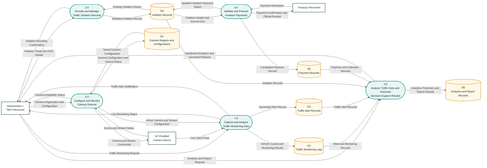

# TRAVIS Data Flow Diagram — Diagram 0

This proposed Diagram 0 is based on the current TRAVIS system and is limited
to five major processes.

## Revised Diagram 0

## Label classification

### Process boxes: verb–object phrases

Each process describes an action performed by the system.

| Process | Verb or action | Object |
|---|---|---|
| Capture and Analyze Traffic Monitoring Data | Capture, Analyze | Traffic Monitoring Data |
| Encode and Manage Traffic Violation Records | Encode, Manage | Traffic Violation Records |
| Analyze Traffic Data and Generate Decision-Support Results | Analyze, Generate | Traffic Data, Decision-Support Results |
| Validate and Process Violation Payments | Validate, Process | Violation Payments |
| Configure and Monitor Camera Devices | Configure, Monitor | Camera Devices |

### Data-flow arrows: noun phrases

The arrow labels describe the data being transferred. They do not describe an
action or command performed by the process.

| Data-flow label | Classification |
|---|---|
| Traffic Monitoring Request | Noun phrase |
| Live Video Feed | Noun phrase |
| Active Camera and Stream Configuration | Noun phrase |
| Vehicle Counts and Monitoring Results | Noun phrase |
| Generated Alert Record | Noun phrase |
| Live Monitoring Status | Noun phrase |
| Traffic Alert Notification | Noun phrase |
| Violation Ticket and OCR Details | Noun phrase |
| Existing Violation History | Noun phrase |
| Validated Violation Record | Noun phrase |
| Violation Encoding Confirmation | Noun phrase |
| Analytics and Report Request | Noun phrase |
| Historical Monitoring Records | Noun phrase |
| Payment and Collection Records | Noun phrase |
| Analytics Prediction and Report Results | Noun phrase |
| Dashboard Analytics and Generated Reports | Noun phrase |
| Payment Information | Noun phrase |
| Violation Details and Amount Due | Noun phrase |
| Completed Payment Record | Noun phrase |
| Updated Violation Payment Status | Noun phrase |
| Payment Confirmation and Official Receipt | Noun phrase |
| Camera Registration and Configuration | Noun phrase |
| Device and Stream Status | Noun phrase |
| Saved Camera Configuration | Noun phrase |
| Camera Configuration and Device Status | Noun phrase |
| Camera and Stream Commands | Noun phrase |
| Camera Availability Status | Noun phrase |

## External entities

| External entity | Role in the DFD |
|---|---|
| Administrator / TMO Personnel | Requests monitoring and analytics, encodes violations, manages cameras, and receives system results. |
| Treasury Personnel | Provides payment information and receives payment confirmation and the official receipt. |
| IoT-Enabled Camera Device | Supplies live video and device status and receives camera or stream configuration commands. |

## Data stores

| ID | Data store | Current database basis |
|---|---|---|
| D1 | Camera Registry and Configurations | `cameras` and calibration configurations |
| D2 | Traffic Monitoring Logs | `camera_monitoring_logs` |
| D3 | Traffic Alert Records | `monitoring_alerts` |
| D4 | Violation Records | `violations` and `violation_items` |
| D5 | Payment Records | `payments` |
| D6 | Analytics and Report Records | `ml_predictions`, `violation_hotspots`, and `reports` |

## Alignment notes

1. Traffic violation detection was replaced with violation encoding and
   management. TRAVIS does not automatically determine ticketable traffic
   violations from the CCTV feed; violations are entered manually or with
   OCR-assisted ticket scanning.
2. The monitoring process covers vehicle counting, inbound and outbound
   counting, congestion assessment, officer-presence detection, collision
   detection, and alert generation.
3. Report generation is included in Process 3.0 to keep Diagram 0 within the
   required maximum of five processes.
4. Camera configuration is kept separate from traffic analysis. Process 5.0
   manages devices and stream settings, while Process 1.0 processes the live
   feed and stores monitoring results.
5. Every external-entity-to-store and store-to-store flow passes through a
   process, following DFD rules.

