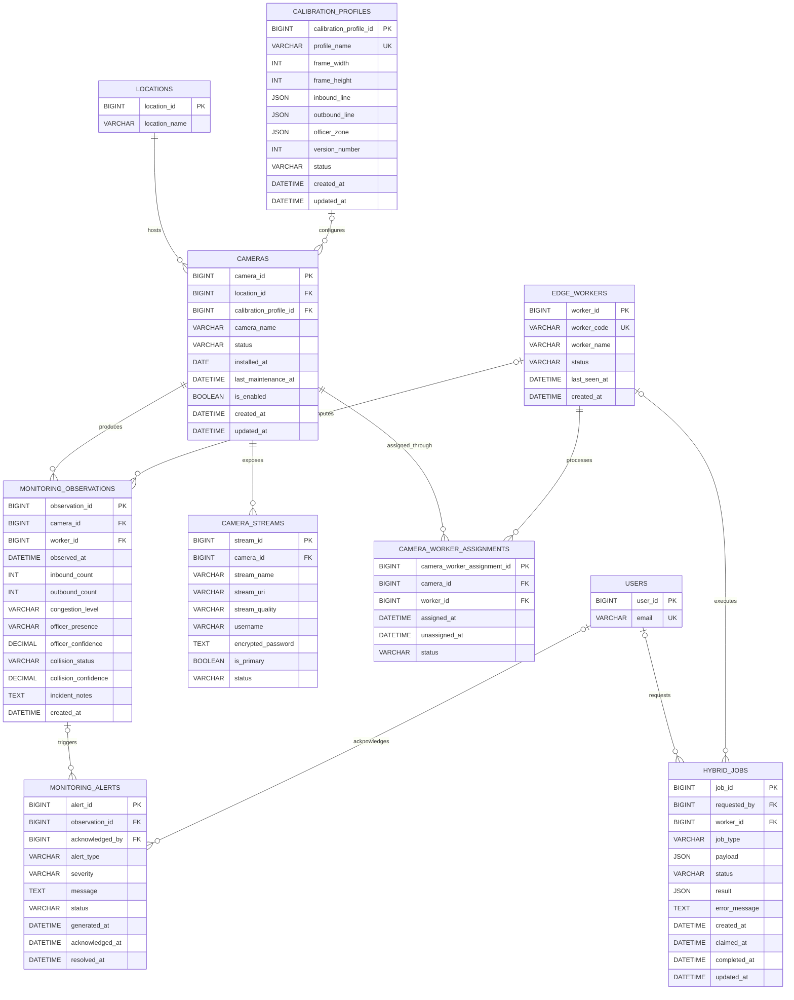
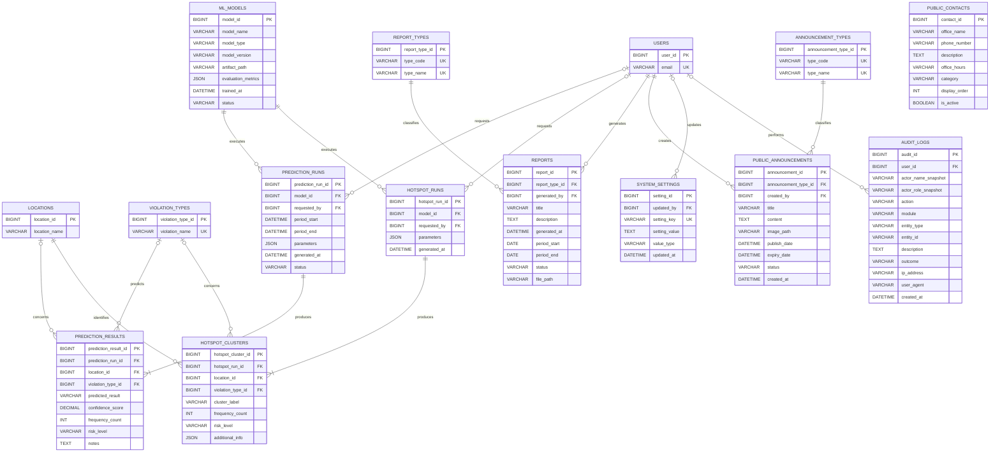

# Proposed Normalized Database ERD for TRAVIS

> **Design document only.** This file does not represent a database migration
> and does not modify the local or VPS database. It is a proposed normalized
> logical model based on the current TRAVIS schema in `database/travis.sql`,
> its extension scripts, and `docs/DATABASE_ERD.md`.

## Purpose and normalization scope

The proposed model targets practical Third Normal Form (3NF):

1. Each table represents one subject or business event.
2. Repeating groups are moved to child or bridge tables.
3. Descriptive values that are reused by multiple records are referenced by
   keys instead of being copied as free text.
4. Attributes depend on the key, the whole key, and nothing but the key.
5. Historical transaction facts, such as the penalty assessed on a citation,
   remain on the transaction even when a reference rate later changes.

Controlled status values may still be implemented as `ENUM`, `CHECK`
constraints, or lookup tables. Their physical implementation can be selected
if this design is ever converted into a migration.

## 1. Identity, enforcement, violations, and payments

```mermaid
erDiagram
    ROLES {
        BIGINT role_id PK
        VARCHAR role_code UK
        VARCHAR role_name UK
        TEXT description
    }

    PEOPLE {
        BIGINT person_id PK
        VARCHAR first_name
        VARCHAR middle_name
        VARCHAR last_name
        VARCHAR suffix
        DATE birth_date
        VARCHAR address
        VARCHAR contact_number
        VARCHAR email
        DATETIME created_at
        DATETIME updated_at
    }

    USERS {
        BIGINT user_id PK
        BIGINT person_id FK
        BIGINT role_id FK
        VARCHAR email UK
        VARCHAR password_hash
        VARCHAR status
        DATETIME created_at
        DATETIME updated_at
    }

    DRIVERS {
        BIGINT driver_id PK
        BIGINT person_id FK,UK
        DATETIME created_at
        DATETIME updated_at
    }

    DRIVER_LICENSES {
        BIGINT license_id PK
        BIGINT driver_id FK
        VARCHAR license_number UK
        DATE issued_date
        DATE expiry_date
        VARCHAR status
        DATETIME created_at
        DATETIME updated_at
    }

    LOCATIONS {
        BIGINT location_id PK
        VARCHAR location_name
        VARCHAR street_details
        VARCHAR barangay
        VARCHAR municipality
        VARCHAR province
        DECIMAL latitude
        DECIMAL longitude
        VARCHAR status
    }

    ENFORCEMENT_ZONES {
        BIGINT zone_id PK
        BIGINT location_id FK
        VARCHAR zone_name UK
        TEXT description
        VARCHAR status
    }

    ENFORCER_RANKS {
        BIGINT rank_id PK
        VARCHAR rank_code UK
        VARCHAR rank_name UK
    }

    TRAFFIC_ENFORCERS {
        BIGINT enforcer_id PK
        BIGINT person_id FK,UK
        BIGINT rank_id FK
        VARCHAR badge_number UK
        DATE hire_date
        VARCHAR employment_status
        DATETIME created_at
        DATETIME updated_at
    }

    ENFORCER_EMERGENCY_CONTACTS {
        BIGINT contact_id PK
        BIGINT enforcer_id FK
        VARCHAR contact_name
        VARCHAR relationship
        VARCHAR contact_number
        BOOLEAN is_primary
    }

    ENFORCER_ASSIGNMENTS {
        BIGINT assignment_id PK
        BIGINT enforcer_id FK
        BIGINT zone_id FK
        DATE assigned_from
        DATE assigned_until
        VARCHAR status
        BIGINT assigned_by FK
    }

    ENFORCER_DUTY_SCHEDULES {
        BIGINT schedule_id PK
        BIGINT enforcer_id FK
        BIGINT zone_id FK
        DATE duty_date
        TIME shift_start
        TIME shift_end
        TIME break_start
        TIME break_end
        VARCHAR status
        VARCHAR notes
    }

    ENFORCER_PRESENCE_LOGS {
        BIGINT presence_id PK
        BIGINT enforcer_id FK
        BIGINT zone_id FK
        BIGINT camera_id FK
        DATETIME observed_at
        VARCHAR presence_status
        DECIMAL confidence_score
        BIGINT recorded_by FK
        VARCHAR remarks
    }

    VEHICLE_TYPES {
        BIGINT vehicle_type_id PK
        VARCHAR type_code UK
        VARCHAR type_name UK
        BOOLEAN is_active
    }

    VEHICLES {
        BIGINT vehicle_id PK
        BIGINT vehicle_type_id FK
        VARCHAR color
        DATETIME created_at
        DATETIME updated_at
    }

    VEHICLE_REGISTRATIONS {
        BIGINT registration_id PK
        BIGINT vehicle_id FK
        VARCHAR registration_number UK
        VARCHAR plate_number UK
        VARCHAR coding_sticker_number
        DATE valid_from
        DATE valid_until
        VARCHAR status
    }

    VEHICLE_OWNERSHIPS {
        BIGINT ownership_id PK
        BIGINT vehicle_id FK
        BIGINT owner_person_id FK
        DATE owned_from
        DATE owned_until
        BOOLEAN is_current
    }

    INSURANCE_POLICIES {
        BIGINT insurance_id PK
        BIGINT vehicle_id FK
        VARCHAR policy_number UK
        VARCHAR provider_name
        DATE valid_from
        DATE valid_until
        VARCHAR status
    }

    TRANSPORT_GROUPS {
        BIGINT group_id PK
        VARCHAR group_type
        VARCHAR group_name UK
        VARCHAR status
    }

    VEHICLE_GROUP_MEMBERSHIPS {
        BIGINT membership_id PK
        BIGINT vehicle_id FK
        BIGINT group_id FK
        VARCHAR membership_number
        DATE joined_at
        DATE ended_at
        VARCHAR status
    }

    VIOLATION_TYPES {
        BIGINT violation_type_id PK
        VARCHAR violation_code UK
        VARCHAR violation_name UK
        TEXT description
        BOOLEAN is_active
    }

    PENALTY_SCHEDULES {
        BIGINT penalty_schedule_id PK
        BIGINT violation_type_id FK
        SMALLINT offense_number
        DECIMAL prescribed_amount
        DATE effective_from
        DATE effective_until
    }

    CITATIONS {
        BIGINT citation_id PK
        VARCHAR ticket_number UK
        BIGINT driver_id FK
        BIGINT vehicle_id FK
        BIGINT location_id FK
        BIGINT apprehending_enforcer_id FK
        BIGINT encoded_by FK
        DATE violation_date
        TIME violation_time
        DATETIME apprehension_datetime
        BOOLEAN license_presented
        BOOLEAN license_confiscated
        BOOLEAN plate_presented
        VARCHAR license_remarks
        TEXT ticket_remarks
        VARCHAR input_method
        VARCHAR status
        DATETIME created_at
        DATETIME updated_at
    }

    CITATION_OFFENSES {
        BIGINT citation_offense_id PK
        BIGINT citation_id FK
        BIGINT violation_type_id FK
        BIGINT penalty_schedule_id FK
        SMALLINT offense_number
        DECIMAL assessed_penalty
        DECIMAL ocr_confidence
        DATETIME created_at
    }

    PAYMENT_METHODS {
        BIGINT payment_method_id PK
        VARCHAR method_code UK
        VARCHAR method_name UK
        BOOLEAN is_active
    }

    PAYMENTS {
        BIGINT payment_id PK
        BIGINT payment_method_id FK
        BIGINT received_by FK
        VARCHAR official_receipt_number UK
        VARCHAR receipt_reference
        DECIMAL amount_received
        VARCHAR payment_status
        DATETIME payment_date
        DATETIME created_at
    }

    PAYMENT_ALLOCATIONS {
        BIGINT allocation_id PK
        BIGINT payment_id FK
        BIGINT citation_id FK
        DECIMAL allocated_amount
    }

    ROLES ||--o{ USERS : grants
    PEOPLE o|--o| USERS : owns_account
    PEOPLE ||--o| DRIVERS : identifies
    DRIVERS ||--o{ DRIVER_LICENSES : holds

    PEOPLE ||--o| TRAFFIC_ENFORCERS : identifies
    ENFORCER_RANKS ||--o{ TRAFFIC_ENFORCERS : classifies
    TRAFFIC_ENFORCERS ||--o{ ENFORCER_EMERGENCY_CONTACTS : has
    TRAFFIC_ENFORCERS ||--o{ ENFORCER_ASSIGNMENTS : receives
    ENFORCEMENT_ZONES ||--o{ ENFORCER_ASSIGNMENTS : covers
    USERS ||--o{ ENFORCER_ASSIGNMENTS : assigns
    TRAFFIC_ENFORCERS ||--o{ ENFORCER_DUTY_SCHEDULES : follows
    ENFORCEMENT_ZONES ||--o{ ENFORCER_DUTY_SCHEDULES : schedules_at
    TRAFFIC_ENFORCERS ||--o{ ENFORCER_PRESENCE_LOGS : appears_in
    ENFORCEMENT_ZONES ||--o{ ENFORCER_PRESENCE_LOGS : observed_at
    USERS o|--o{ ENFORCER_PRESENCE_LOGS : records

    LOCATIONS ||--o{ ENFORCEMENT_ZONES : defines
    VEHICLE_TYPES ||--o{ VEHICLES : classifies
    VEHICLES ||--o{ VEHICLE_REGISTRATIONS : registers
    VEHICLES ||--o{ VEHICLE_OWNERSHIPS : has
    PEOPLE ||--o{ VEHICLE_OWNERSHIPS : owns
    VEHICLES ||--o{ INSURANCE_POLICIES : insures
    VEHICLES ||--o{ VEHICLE_GROUP_MEMBERSHIPS : joins
    TRANSPORT_GROUPS ||--o{ VEHICLE_GROUP_MEMBERSHIPS : contains

    DRIVERS ||--o{ CITATIONS : receives
    VEHICLES ||--o{ CITATIONS : involved_in
    LOCATIONS ||--o{ CITATIONS : occurs_at
    TRAFFIC_ENFORCERS o|--o{ CITATIONS : apprehends
    USERS ||--o{ CITATIONS : encodes
    CITATIONS ||--|{ CITATION_OFFENSES : contains
    VIOLATION_TYPES ||--o{ CITATION_OFFENSES : classifies
    VIOLATION_TYPES ||--o{ PENALTY_SCHEDULES : priced_by
    PENALTY_SCHEDULES o|--o{ CITATION_OFFENSES : basis_for

    PAYMENT_METHODS ||--o{ PAYMENTS : used_by
    USERS ||--o{ PAYMENTS : receives
    PAYMENTS ||--|{ PAYMENT_ALLOCATIONS : distributes
    CITATIONS ||--o{ PAYMENT_ALLOCATIONS : settled_by
```

### Important enforcement design decisions

- `people` is the shared identity record. A person may be a driver, system
  user, traffic enforcer, or vehicle owner without duplicating personal data.
- A driver may have multiple license records over time. A citation separately
  stores whether a license or plate was presented during that event.
- `citations` represents the physical ticket, while `citation_offenses`
  represents its one or more checked violations.
- `penalty_schedules` stores ordinance rates and effective dates. The actual
  amount charged remains in `citation_offenses.assessed_penalty` as an
  immutable historical transaction fact.
- Payments and citations are connected through `payment_allocations`. This
  supports the current one-payment workflow and permits partial, combined, or
  corrected payments later without redesigning the schema.
- Current officer assignment is not stored directly on the enforcer record.
  `enforcer_assignments` preserves location-assignment history.

## 2. Cameras, edge processing, monitoring, and alerts

### Monitoring design decisions

- `vehicle_count` is not stored because it is derived as
  `inbound_count + outbound_count`. This avoids inconsistent totals.
- Camera connection details are separated from the physical camera record.
  One camera can expose multiple streams without adding repeated columns.
- Worker assignment history is represented by a bridge table instead of a
  text `edge_worker_id` on `cameras`.
- Calibration data is versioned and reusable. A camera references the active
  profile rather than a profile filename.
- Alerts reference the observation that caused them. A system alert may have
  a null observation when it is not camera-generated.

## 3. Analytics, reports, public content, and governance

### Analytics and governance design decisions

- Model metadata is separated from model execution. One trained model can
  produce many prediction or hotspot runs.
- Each run may produce multiple results, avoiding repeated model/version and
  parameter values on every row.
- Locations and violation types reuse the same master records used by the
  enforcement module.
- Audit actor name and role snapshots are intentionally retained. They are
  historical event facts and allow an audit entry to remain understandable
  after a user profile or role changes.

## Current-to-proposed table mapping

| Current table or columns | Proposed destination | Reason |
|---|---|---|
| `users.role` | `roles` + `users.role_id` | Removes repeated role text and centralizes role metadata. |
| `users.full_name` | `people` name columns; `users.person_id` | Shares structured identity data with enforcers and other people. |
| Driver columns in `violations` | `people`, `drivers`, `driver_licenses` | A driver and license can appear on multiple citations without copying details. |
| Vehicle columns in `violations` | `vehicles`, `vehicle_types`, `vehicle_registrations`, `insurance_policies` | Separates vehicle identity, registration, type, and policy lifecycles. |
| `vehicle_owner` | `vehicle_ownerships` + `people` | Replaces repeated owner names and preserves ownership history. |
| `vehicle_toda` | `transport_groups` + `vehicle_group_memberships` | Represents TODA membership as a relationship rather than free text. |
| Ticket facts in `violations` | `citations` | Keeps only facts belonging to the physical citation event. |
| `violations.violation_type` and `violation_items.violation_type` | `violation_types` + `citation_offenses` | Removes duplicated offense text and supports multiple offenses per ticket. |
| Penalty values in parent and child violation rows | `penalty_schedules` + `citation_offenses.assessed_penalty` | Separates ordinance rate from the historical amount actually assessed. |
| Officer name/position in `violations` | `citations.apprehending_enforcer_id` | Connects citations to the managed enforcer list. Snapshot columns may be retained only if legally required. |
| `officers` personal columns | `people` + `traffic_enforcers` | Separates identity from employment data. |
| `officers.zone_id` | `enforcer_assignments` | Preserves assignment history instead of only the latest zone. |
| Emergency contact columns in `officers` | `enforcer_emergency_contacts` | Supports multiple contacts without repeating columns. |
| `officer_duty_schedules` | `enforcer_duty_schedules` | Adds zone and break details while retaining one schedule event per row. |
| `payments.violation_id` | `payments` + `payment_allocations` | Decouples the receipt/payment event from what it settles. |
| Camera connection columns in `cameras` | `camera_streams` | Supports multiple stream profiles and isolates credentials. |
| `cameras.location` | `cameras.location_id` + `locations` | Reuses a consistent location master. |
| `cameras.calibration_profile` | `calibration_profiles` | Replaces filename/text coupling with a versioned configuration entity. |
| `cameras.edge_worker_id` | `edge_workers` + `camera_worker_assignments` | Adds referential integrity and assignment history. |
| `camera_monitoring_logs.vehicle_count` | Derived from inbound + outbound | Removes a value that can contradict its components. |
| `camera_monitoring_logs` | `monitoring_observations` | Models each CV measurement as one observation event. |
| `ml_predictions` | `ml_models`, `prediction_runs`, `prediction_results` | Separates model, execution, and output data. |
| `violation_hotspots` | `hotspot_runs`, `hotspot_clusters` | Groups cluster outputs under the run that generated them. |
| `reports.report_type` | `report_types` | Provides a controlled catalog of supported report types. |
| `public_announcements.announcement_type` | `announcement_types` | Centralizes announcement classifications. |
| `hybrid_jobs.worker_id` and `requested_by` | Foreign keys to `edge_workers` and `users` | Replaces unvalidated text/IDs with explicit relationships. |

## Proposed keys and cardinality rules

| Rule | Proposed constraint |
|---|---|
| One account per email | `users.email` unique |
| One driver profile per person | `drivers.person_id` unique |
| One enforcer profile per person | `traffic_enforcers.person_id` unique |
| One physical ticket number | `citations.ticket_number` unique |
| No duplicate offense on one citation | unique (`citation_id`, `violation_type_id`) on `citation_offenses` |
| One penalty rate per offense level and effective start | unique (`violation_type_id`, `offense_number`, `effective_from`) |
| No duplicate payment allocation | unique (`payment_id`, `citation_id`) |
| One primary stream per camera | filtered/conditional unique rule for active `is_primary` stream |
| One active worker assignment per camera | filtered/conditional unique rule for active assignment |
| No overlapping active vehicle ownership | application or database temporal validation |
| No overlapping active enforcer assignment | application or database temporal validation |

## Derived values that should not be redundantly stored

| Derived value | Source |
|---|---|
| Total vehicle count | `inbound_count + outbound_count` |
| Citation total penalty | Sum of `citation_offenses.assessed_penalty` |
| Citation amount paid | Sum of `payment_allocations.allocated_amount` for completed payments |
| Citation balance | Total penalty minus completed allocations |
| Paid/pending financial state | Citation balance plus cancellation/refund state |
| Driver full name | Structured columns in `people` |
| Current officer zone | Latest active `enforcer_assignments` row |
| Current vehicle owner | Active `vehicle_ownerships` row |

## Assumptions and boundaries

1. This proposal is based on repository schema files, not a live database
   migration or live-data rewrite.
2. A citation can contain multiple offenses, matching the current
   `violation_items` behavior.
3. A person can participate in more than one role. This is why identity is
   separated from driver, user, enforcer, and owner roles.
4. Locations are treated as reusable master records because they are shared by
   citations, cameras, officer zones, predictions, and hotspots.
5. Historical monetary values and audit snapshots are intentionally retained;
   removing them would damage the historical meaning of past transactions.
6. This ERD is a target design only. Before any future implementation, it
   would still require data profiling, migration scripts, reconciliation
   reports, application compatibility work, staged testing, and rollback
   procedures.

## Explicit non-implementation statement

Creating this document did **not** execute SQL, alter a table, migrate a row,
change an API, deploy code, or modify the local/VPS database. It is solely a
normalized ERD proposal for planning, documentation, and academic presentation.
